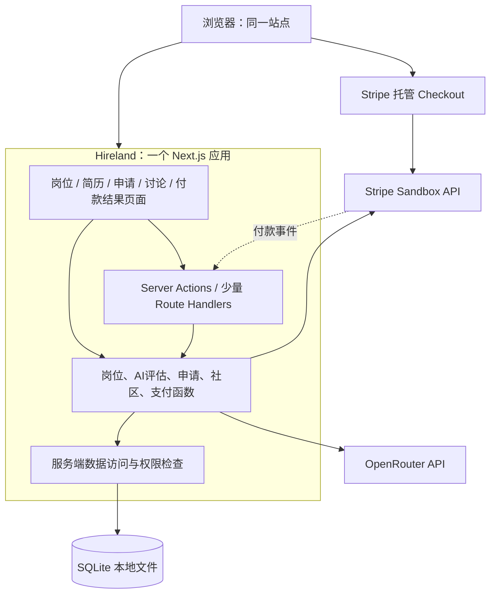

# Hireland：单体架构与比赛交付计划

日期：2026-10-10。状态：设计建议，尚未实现或通过验收。

本计划基于仓库全部业务文档：`00_MASTER_PRD.md`、六页比赛 PDF，以及原本只有项目名称的 README。仓库尚无应用代码、数据库、依赖清单或测试，当前无需迁移旧实现。

## 1. 决策与假设

采用 **一个 Next.js 全栈应用 + 一个本地 SQLite 数据库**。一个代码仓库、一个依赖清单、一个应用启动入口、一个端口；页面、业务逻辑和数据访问在同一应用内。OpenRouter 和 Stripe 是外部供应商，不是团队另建的服务。

主赛道选 **Everyday Frustrations**。核心问题缩小为：爱尔兰应届求职者反复阅读 JD、判断是否值得申请，再手动记录进度。不要因为接入支付而把主赛道改为 FinTech。

核心演示：**选择岗位 → 提供虚构 CV 与偏好 → 获取有依据的 AI 建议 → 保存申请 → 更新状态**。扩展演示：查看同一岗位社区 → sandbox 付费 → 解锁历史评论。

排期假设：3–4 人、约 6 小时有效开发时间，至少一人熟悉 TypeScript/React。PDF 只说一个下午，没有提供精确时长或队伍人数；这些是规划假设，不是比赛规定。若只有 4 小时，使用第 9 节缩减方案。如果团队完全不熟悉该技术栈，应优先使用团队熟悉的全栈框架，但保留单体、共享数据库和以下验收标准。

单体消除独立应用间的 HTTP 合约、端口和部署对接，但仍须验证内部模块组合以及 OpenRouter/Stripe 外部调用；不能把“不做多应用联调”理解成“不做端到端测试”。

## 2. 比赛要求与证据对照

以下页码指比赛 PDF 的物理页码。

| 比赛原文要求 | 位置 | 本项目的交付证据 |
|---|---|---|
| 选择一个主主题 | p1 | README/讲解明确 Everyday Frustrations |
| 说明首批用户、问题、现有办法、采用理由、触达方式，区分证据与假设 | p1、p3 | 简短用户画像、真实反馈记录、首批触达方案 |
| 一个可运行工作流程；本地运行足够 | p1 | 从岗位到 AI 建议和申请状态的一次完整操作 |
| 通过 OpenRouter API 提供有用功能；仅用 AI 写代码不算 | p1、p3–4 | 实际请求、实际输出、输入输出质量对照与失败处理 |
| 调查一个用户假设；测试正常、边界、失败输入，并说明所学或修改 | p1、p3 | 假设→观察→结论→修改记录，以及测试结果 |
| 使用公共或合成数据，注明来源与假设；声称节省时要给比较基线 | p2 | 数据说明、界面 synthetic 标签；若有节时数据，记录任务和测量方式 |
| 五项各 10 分：Users first、Craft and beauty、Urgency and focus、Stay curious、AI usage | p3 | 第 10 节验收和第 11 节演示覆盖五项 |
| Stripe 可选加分，只有 0 或 5 分 | p4–6 | 非零价格、真实 sandbox Checkout、成功交易、产品内权益 |

基础分是各评委 50 分总分的平均值，再加一次 Stripe bonus，上限 55。没有演示 OpenRouter 功能时，AI usage 为零，其他项正常评审；不是自动取消参赛资格。但本项目必须把真实 OpenRouter 闭环作为完成条件。

**PDF 没有要求**：三个应用、生产部署、实时抓取、特定数据库、访谈恰好 3 人、8–12 个岗位、PDF/DOCX 上传或正式注册。原 PRD 里的这些属于产品选择。公共数据列表是起点示例，不是必须采用的数据源。

合规设计不等于已达标：真实调用、用户反馈、交易和测试证据必须由团队实际完成，不能预填“通过”或保证得分。

## 3. 原 PRD 的保留与修改

| 原方案 | 建议调整 | 原因 |
|---|---|---|
| A/B/C 三个独立 App、独立 localhost | 删除；改为同一应用中的岗位、AI、申请、社区、支付业务模块 | 避免账号、数据、导航和跨应用合约重复 |
| JobSnapshot 导出/导入、共享 contracts 包 | 删除；使用同一 Job 行与内部类型 | 数据无需复制到三个数据库 |
| 统一导航壳为 P1 | 改为 P0，从第一小时就有共同页面布局 | 完整体验是评分项 |
| 三职业方向、大量搜索筛选 | 首先只做 Technology graduate/junior 与关键词搜索 | 先验证一个具体用户群；其他方向留待后续 |
| 爬取/刷新、公司关注、站内通知均为 P0 | 移至 P1 | 实时源不是比赛要求，不能挤占 AI、用户验证和测试 |
| PDF/DOCX/TXT 全格式 CV | P0 做粘贴文本和“加载虚构 CV”；文件上传移至 P1 | 文件解析不是核心价值，扫描 PDF 更易拖慢进度 |
| Match 和 Should I Apply 各一次模型调用 | 合并为一次评估，返回建议、分数及证据 | 降低延迟和两个输出互相矛盾的风险 |
| 首屏自动评估 3 个岗位 | 移至 P1；P0 用户点击后计算 | 控制费用、重复请求和错误状态数量 |
| 社区与 Stripe 与主流程同为 P0 | 标为 P0-Bonus，排在核心闭环后 | 明确可选加分与基本交付的关系；仍以完成它为 6 小时目标 |
| 只输出 YES/NO | 保留方向建议，但允许 NEEDS_REVIEW；缺少必要输入直接校验失败 | 信息不足与“不建议申请”不能混为一谈 |

### 范围分层

- **P0-Core**：8–12 条标注来源的种子岗位、列表/详情、CV 文本与偏好、真实 OpenRouter 评估、申请新增/状态修改/删除、本地持久化、统一导航、正常/边界/失败反馈、用户验证与演示证据。
- **P0-Bonus**：同一 Job 的讨论话题、至少 6 条标为虚构的种子评论、发评论、服务端限制最新 3 条、€0.99 EUR 单话题一次性 sandbox 解锁、付款验证与订单状态。
- **P1**：文本 PDF/TXT 上传、更多职业方向、公司关注与手动刷新提醒、公开岗位源、更多过滤条件。DOCX 排在文本 PDF 之后；OCR 不做。
- **本次不做**：多服务、独立 Python API、任务队列、向量数据库、RAG、Agent 编排、自动投递、全网爬虫、正式账户体系、邮件、真实收款、云端部署作为交付前置条件。

## 4. 架构



### 技术与运行决策

| 层 | 建议 | 约束 |
|---|---|---|
| 页面及服务端 | Next.js App Router + TypeScript，Node.js runtime | 不另建 Vite SPA、Express 或 FastAPI；开工时锁定验证过的版本 |
| 样式 | 团队熟悉的轻量方案，优先基础 CSS 和少量复用组件 | 不花时间搭建完整设计系统 |
| 数据 | SQLite + 一个服务端数据访问层 | 单机单实例；不用另起数据库服务器；实现时选择并锁定一个可用驱动 |
| AI | 服务端直接调用 OpenRouter，JSON Schema 输出并再次校验 | 密钥不进入浏览器；不需要额外 AI 编排框架 |
| 支付 | Stripe 托管 Checkout，单次购买 | 所有价格和权益由服务器决定，仅 sandbox |
| 用户 | 一个固定 demo 用户，服务端统一取得身份 | 不接收客户端传来的 userId 作为权限依据；不是多用户生产系统 |
| 部署 | 本机运行并现场演示 | 数据库文件持久保存；联网用于 AI 与支付，不要求部署 |

Server Components 直接调用服务端业务函数读数据，交互提交统一用 Server Actions；不要由服务器再 HTTP 调用自己的 `/api`。支付 webhook 保留 Route Handler。此方式符合 [Next.js 官方全栈数据读取说明](https://nextjs.org/docs/app/guides/backend-for-frontend)。

按需动态读取用户记录、AI 结果和权益，不做跨用户共享页面缓存；写入后刷新对应页面。即使使用 demo 身份，评论付费墙也必须存在于数据访问层，未授权评论正文不得进入页面 HTML、组件序列化数据或接口响应。

### 建议目录（待实现）

```text
src/
  app/
    layout.tsx
    page.tsx                    # 岗位列表
    profile/page.tsx             # CV 文本与职业偏好
    jobs/[jobId]/page.tsx        # JD、AI 建议、保存申请、话题入口
    applications/page.tsx        # 用列表+状态下拉框即可，无需拖拽
    topics/[topicId]/page.tsx
    checkout/return/page.tsx
    api/stripe/webhook/route.ts
  components/                   # 导航、岗位卡、评估卡、错误提示
  server/
    identity.ts                 # getCurrentDemoUser()
    db.ts
    jobs.ts
    profile.ts
    assessments.ts
    applications.ts
    community.ts
    billing.ts
    providers/openrouter.ts
    providers/stripe.ts
  actions/                      # 很薄的校验、业务调用、页面刷新
  shared/                       # 无密钥、无数据库依赖的类型/枚举
data/seed/                      # 岗位、虚构 CV、虚构评论及数据说明
db/migrations/
scripts/                        # 初始化、seed、仅本地 demo reset
tests/
Doc/evidence/                   # 真实访谈、测试、模型评估、交易证据
```

这些文件夹不是独立应用。服务器模块标记为 server-only，客户端组件不得导入数据库或供应商密钥代码。一个人负责 schema 与初始化，避免多成员分别创建用户、Job 和 Entitlement 的不同版本。

## 5. 数据模型与内部接口

| 表 | 主要字段 | 不变量 |
|---|---|---|
| User | id、demoName | 一个本地演示用户 |
| Profile | userId、cvText、cvHash、preferencesJson、updatedAt | userId 唯一；CV 更新后评估不能命中旧内容 |
| Job | id、jobKey、company、title、location、category、description、sourceType、sourceUrl、applyUrl、publishedAt、lastCheckedAt、status | jobKey 唯一；日期可空；未知不写“开放中” |
| Assessment | userId、jobId、inputHash、promptVersion、modelId、resultJson、createdAt | 用户、完整输入 hash、prompt 版本与模型共同确定缓存键 |
| Application | userId、jobId、status、createdAt、updatedAt | userId + jobId 唯一 |
| Topic | id、jobId | MVP 每个 Job 至多一个话题；无手动创建孤立话题 |
| Comment | topicId、authorLabel、body、isSynthetic、createdAt | 正文长度 1–1000；按时间和 id 稳定排序 |
| Purchase | id、userId、topicId、expectedAmount、currency、stripeSessionId、status | Session ID 唯一，价格固定为 99 欧分；创建中可暂时没有 Session ID |
| Entitlement | userId、topicId、purchaseId、grantedAt | userId + topicId 唯一 |

Job.id 是内部关联键；jobKey 只用于数据导入去重，synthetic 数据使用固定 ID，公共来源优先用“来源 + 原始岗位 ID”，不得仅凭公司名和标题判定相同岗位。

申请状态保留 `SAVED / APPLIED / INTERVIEW / OFFER / REJECTED`，允许纠正误操作。保存同一岗位两次仍只有一条申请。保存表示加入追踪，不代表已经向公司提交申请。

只定义少量进程内接口，不建立通用 REST API：

| 函数 | 输入 | 结果 |
|---|---|---|
| listJobs / getJob | 搜索条件 / jobId | 岗位列表 / JD |
| saveProfile | cvText、preferences | 校验后持久化 |
| assessJob | jobId | 服务端读取 Profile 与 Job，返回 Assessment |
| saveApplication / updateApplication | jobId / applicationId + status | 当前用户的申请记录 |
| getTopicComments | topicId | 按当前用户权益返回 3 条或完整评论 |
| addComment | topicId、body | 持久化后重新查询；不直接追加成免费第 4 条 |
| createCheckout | topicId | 服务器生成 Checkout URL |
| fulfillCheckout | sessionId | 校验、幂等写订单与权益 |

上述函数统一从服务端身份上下文取得用户，webhook 则从本地 Purchase 关联用户，不依赖浏览器登录态。

## 6. AI 设计与质量判断

1. 用户加载虚构 CV 或粘贴文本，选择求职偏好；允许编辑。
2. 点击“分析这个岗位”。服务端检查 CV/JD 非空、长度上限；建议初始上限分别为 12,000 与 20,000 字符，超长明确提示精简，避免静默截断关键条件。
3. 组合规范化 CV、JD、职业偏好、promptVersion、modelId 生成缓存键。职业偏好变化同样必须使缓存失效。
4. 未命中缓存才请求 OpenRouter，一次生成全部结果。每位演示用户最多一个进行中的请求，重复点击复用该请求；建议 20 秒超时、至多一次用户主动重试。
5. 选择当天实际验证可用、支持 structured outputs 的模型；名称通过配置设置，不在计划里承诺某模型价格或可用性。用严格 JSON Schema，并在服务器再次校验范围与枚举。[OpenRouter 文档](https://openrouter.ai/docs/guides/features/structured-outputs)说明了结构化输出及模型支持要求。
6. 输出建议 `YES / NO / NEEDS_REVIEW`、可空 `score`、一句话理由、最多 2 项优势和 2 项不足、CV/JD 证据片段、待确认项。JSON 正确不等于内容正确，证据还要对照原输入。
7. 输入缺失是校验错误；有效但无法判断的输入返回 NEEDS_REVIEW；调用失败是错误状态。三者均不能伪装成 NO 或 0 分。
8. 分数只表示基于当前材料的启发式匹配度，不是录用概率。说明哪些 JD 要求有证据、哪些在 CV 中未体现；未写某项技能不等于确定不会。

CV/JD 当作数据，不能覆盖系统指令；不提供工具执行或网页抓取能力。页面提醒文本将发送给外部 AI，比赛默认只用虚构 CV；不在日志中记录完整简历或密钥。清空 Profile 后同步删除其相关评估记录。

准备至少 4 组质量样例：明显匹配、明显不匹配、关键条件不明、JD 含“忽略之前指令”干扰文本。人工检查建议是否有依据、是否捏造经历、是否承认未知，不以某个精确分数作为测试通过条件。再用空输入和模型超时验证错误路径。

离线 fixtures 只用于开发和明确标注的演示回放。至少一条评估必须真实经过 OpenRouter；录屏和历史结果可作故障备份，但不能保证替代现场演示取得 AI 分。

## 7. Stripe 与社区设计

产品选项：**€0.99 EUR / 单个岗位话题 / 一次性解锁历史评论，sandbox only**。免费部分为最新 3 条，付费范围明确；测试数据和虚构评论须标注。这是初始定价假设，不是已证实的付费意愿，也不承诺消息真实或工作机会。

付款路径：服务器创建 Purchase → 创建绑定 purchaseId 的 Stripe Checkout Session → 浏览器跳转托管页面 → sandbox 支付 → 服务端确认 → 本地订单与权益入库 → 重新读取评论。

确认函数只给通过以下检查的订单发权益：服务端向 Stripe 查询真实 Session；sandbox 模式；`payment_status=paid`；单次支付；商品、数量、金额 99 欧分、EUR 与本地订单一致；Session 与本地 Purchase 对应。浏览器返回页还需确认 Purchase 属于当前用户。价格、userId 和权益均不能由 URL 或前端字段决定。

采用同一 `fulfillCheckout(sessionId)` 供返回页与签名验证后的 webhook 调用，以数据库事务和唯一约束防止重复发权益。写入失败时保留可重试状态，不显示已解锁。Webhook 使用原始请求体验签；在本地接收事件的转发工具只是开发工具，不是第二个业务应用。Stripe 官方建议 webhook 与返回页共同触发幂等履约，避免用户付款后关闭页面而漏发权益。[官方说明](https://docs.stripe.com/checkout/fulfillment)

P0-Bonus 只开放即时卡支付；不引入订阅、延迟支付、税费或优惠券。已解锁话题直接阅读，不重复购买。取消/失败不解锁；付款成功但查询失败显示“确认中”并允许重试，不能让用户重新付费解决。

若时间只够做返回页服务端核验，可作为受控 demo 的缩减版本：仍需真实 sandbox 付款和产品权益，但必须标注“付款后未返回应用可能不自动解锁”，提供再次核验入口；这不是完整可靠的支付履约实现。不要把可选技术措施误写成 PDF 的明确规定。

## 8. 用户验证与数据证据

目标访谈 3 位有求职经验的学生，这是团队执行目标，PDF 没有规定样本数。访谈从 M0 开始，不等功能完成。

聚焦一个假设：“同一页面提供有依据的申请建议和保存入口，能帮助学生完成初筛。”先问最近一次怎么找工作、怎么决定申请、怎么记录；再观察其完成原型任务。避免只问“你会不会用我们的产品”。另外询问社区历史信息的价值与付费顾虑，允许结论是不愿付费。

每条记录填写：匿名编号、时间、当前办法、原话或观察、支持/反驳哪个假设、决定修改什么。至少完成一项由真实反馈引发的修改，例如突出证据、调整按钮或移除误导标签；这些是可能的修改，不是预设研究结论。

若测时间，记录同一人处理可比 JD 时的起止定义、先后顺序、耗时与是否正确理解。小样本只报告观察，不能推断总体节省百分比。未测量时仅说“减少页面切换”，不编造节时数字。

数据默认使用 8–12 条原创 synthetic 岗位、一个虚构 CV、一个话题至少 6 条虚构评论。数据说明记录来源类型、生成方式、日期、已知限制；虚构岗位的 Apply 按钮不应链接到伪造招聘页面。真实公开岗位若加入，补充来源链接、获取日期、使用条件和状态未知说明。

`Doc/evidence/` 待实施时保存：用户反馈、数据来源、AI 输入输出评估、测试结果、成功 sandbox Session 的非敏感标识和产品解锁截图、演示流程。当前尚无这些证据。

## 9. 实施计划与里程碑

默认 6 小时，是团队总工作窗口；成员在同一应用中按业务切片并行开发，不是把表中工时逐人相加。每个里程碑必须在主干版本上验收。

| 里程碑 | 时间窗口 | 产出与退出条件 | 依赖 / 超时处理 |
|---|---|---|---|
| M0 锁定范围、排除外部阻塞 | 0:00–0:30 | 主主题、demo 用户、统一 schema/函数签名；确认 OpenRouter 可真实调用、Stripe sandbox 可访问；开始访谈 | 无；额度/账号问题现在暴露；Stripe 未就绪不阻塞核心 |
| M1 同一应用可走通静态旅程 | 0:30–1:15 | 单启动入口、DB 初始化与 seed、岗位列表/详情、Profile、申请保存与状态更新；重启数据仍在 | M0；不做爬虫、不做上传、不做拖拽 |
| M2 真实 AI 核心闭环 | 1:15–2:30 | CV→真实 OpenRouter→有依据的评估→保存申请；至少匹配/不匹配/未知/超时可检查；首位用户试用 | M1；2:30 仍未完成则冻结所有 bonus 新功能，全力修复核心 |
| M3 社区和完整支付 | 2:30–4:00 | 3/6 评论限制、发评论、真实 sandbox 成功付款、服务端确认、解锁持久化；取消和重复确认正常 | M1 数据结构，可提前开发但不得抢占 M2；4:00 停止新增功能 |
| M4 质量与用户反馈迭代 | 4:00–5:00 | 用户反馈落地至少一次调整；关键正常/边界/失败用例通过；付费正文无泄漏 | M2；M3 若未完成则移出演示，不宣称获得 bonus |
| M5 冻结与演示 | 5:00–6:00 | 干净环境复现、两次完整彩排、证据整理、录屏备份；价格和 synthetic 标签清楚 | 最后一小时不加 P1；只修演示阻断问题 |

**依赖链：M0 → M1 → M2 → M4 → M5。** M3 是 M1 后的 bonus 支线，用户访谈贯穿 M0–M4，不能等到 M5 才开始。最高风险是 OpenRouter/Stripe 可用性和末尾证据缺失，不是页面数量。

### 同一应用内的分工

| 成员 | 负责切片 | 尽量独占的文件范围 |
|---|---|---|
| A：基础与岗位 | 初始化、schema、seed、岗位和申请持久化 | db、jobs、applications、迁移 |
| B：AI | Profile、评估服务、输出卡片与失败态 | profile、assessments、OpenRouter adapter |
| C：社区与付款 | 话题、评论、付费墙、Checkout、权益 | community、billing、Stripe adapter |
| D：体验与验证（若有） | 导航与基础样式、访谈、测试、演示 | layout、通用 UI、evidence |

只有 3 人时，A 负责统一页面外壳，B/C 各安排短时用户访谈并交换测试；压缩样式和 P1。schema、公共类型和锁文件由 A 统一处理，新增依赖先在组内同步。所有人针对同一个 seed 数据和同一函数签名开发，每 45–60 分钟合入小改动并验证已有主流程。不要按“前端/后端/数据”分成三个等待对接的团队。

### 只有 4 小时时

- 0:00–0:20：账号验证、范围/schema 确认与开始访谈。
- 0:20–1:00：岗位、CV 文本、申请记录与导航。
- 1:00–2:00：真实 AI 与错误处理，必须完成核心闭环。
- 2:00–2:45：只有核心已稳定且支付成员已有可运行切片时才完成 bonus；否则用于测试与反馈修改。
- 2:45–4:00：验收、研究证据、修复、彩排；停止所有新功能。

更短时间下舍弃 Stripe 可以仍满足基础参赛期望，但失去可选 5 分机会。不得舍弃真实 AI、完整工作流和验证证据来保住支付按钮。

## 10. 测试与完成定义

下表是实施后的验收清单，当前状态均为“待执行”。业务断言优先测试数据库与供应商边界；一条浏览器完整旅程配合人工演示即可，不为每个视觉组件编写测试。

| 类别 | 用例 | 通过条件 |
|---|---|---|
| 正常 | 虚构 CV + 匹配 JD | 真实 OpenRouter 响应，有可核对证据，无编造经历 |
| 正常 | 保存申请、改 APPLIED、重启 | 状态持久化；没有实际投递的误导 |
| 边界 | 重复保存 / 重复 seed | 不生成重复申请或重复岗位 |
| 边界 | 空 CV、超长输入、缺失日期、零搜索结果 | 明确反馈，不崩溃、不把未知显示为确定事实 |
| 边界 | 改 CV 或偏好后再次分析 | 不复用过期评估；模型/prompt 更换同理 |
| 失败 | OpenRouter 超时、限流、非法 JSON、越界分数 | 用户可重试；不伪造结果、不覆盖有效历史结果 |
| 质量 | 关键条件不明 / JD 含指令干扰 | 承认不确定，不服从 JD 内指令，不捏造证据 |
| 正常（bonus） | 免费访问至少 6 条评论的话题 | 页面及网络响应仅有最新 3 条正文；总数可显示 |
| 正常（bonus） | €0.99 sandbox 成功支付 | 订单已付、正确话题解锁、刷新与重启仍有效 |
| 边界（bonus） | 重复返回 / webhook 重试及并发 | 一份权益；重复请求成功返回已有结果 |
| 失败（bonus） | 取消、未支付、篡改 session、错误金额/归属 | 不发权益，不允许读取完整评论 |
| 失败（bonus） | 付款成功但数据库写入失败 / 返回页未打开 | 可通过后续核验或 webhook 重试恢复；未确认时显示确认中 |
| 失败（bonus） | webhook 签名不合法 | 拒绝处理 |

Core DoD：一个应用在另一位成员机器按 README 初始化并启动；核心旅程走到底；真实 OpenRouter；公开/合成来源说明；用户假设检验与所学；正常、边界、失败证据；统一界面及可理解的错误提示。Bonus DoD：额外满足 PDF p6 四项并展示成功交易与产品权益。

没有网络时，岗位和申请仍能工作，AI/付款明确提示不可用。可展示已标注的历史录屏，但不能将其包装为实时结果。Demo reset 仅用于本地演练，显式触发，不在启动时自动删除权益或测试证据。

## 11. 建议演示脚本

以下 4 分钟是建议时长，PDF 未指定展示时限。

1. **0:00–0:30**：是谁遇到什么问题，原来如何处理；展示一条真实用户反馈，明确尚未验证的假设。
2. **0:30–1:40**：加载虚构 CV，选择岗位，真实调用 OpenRouter，展示建议及对应证据；解释分数不是录用概率。
3. **1:40–2:10**：保存岗位，更新申请状态；说明保存和真实申请的区别。
4. **2:10–3:10**：若 bonus 完成，展示 3 条免费评论、€0.99 sandbox Checkout、成功交易和全部评论解锁。
5. **3:10–4:00**：展示一次信息不足/失败处理、因用户反馈作出的修改、数据来源、首批触达渠道和局限。

优先说清“我们验证了什么”，再说“以后还能做什么”。不宣称抓取了全网岗位，不宣称评论来自真实申请者，不把测试付款当作收入或付费意愿证据。

## 12. 设计依据与后续使用

- 比赛依据：[HackUCD 2026 PDF](hackucd-2026-challenges.pdf)，已核对全部六页。
- 需求输入：[原始 PRD v1](00_MASTER_PRD.md)，保留便于追溯；其中三应用架构不再适用。
- 技术依据：通过 Context7 查询 Next.js、OpenRouter 和 Stripe 官方资料；支付履约另核对 Stripe 官方页面。实现前仍需在所选锁定版本上验证，本文不是已运行的技术栈证明。
- 后续开发先完成 M0/M1，再逐项填写验收结果；不要直接把全部旧 P0 同时开工。
